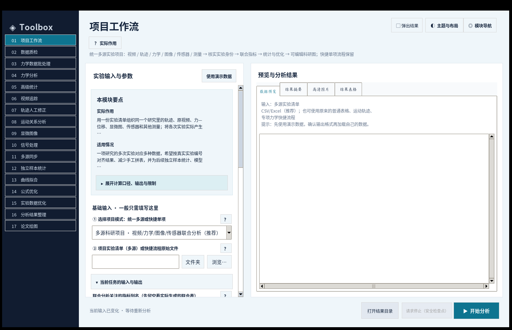
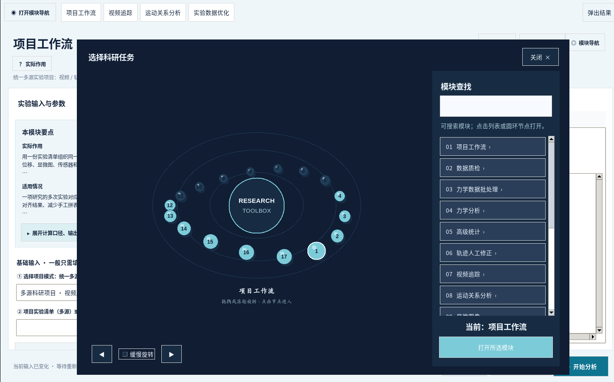
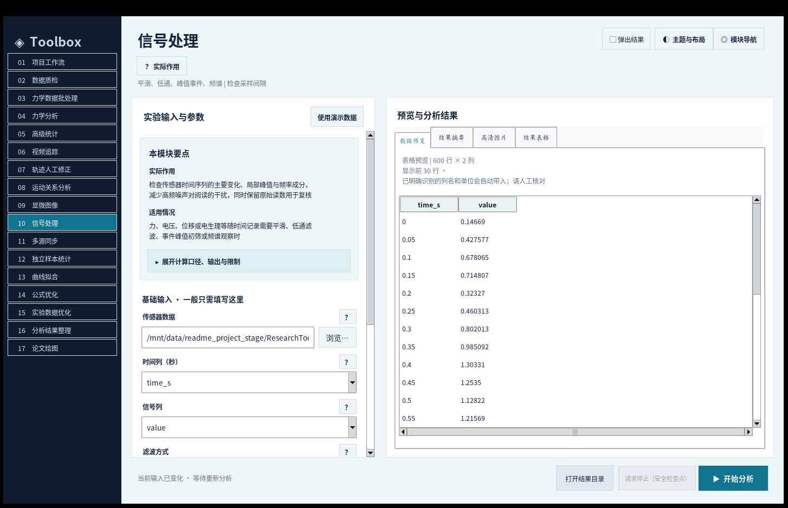
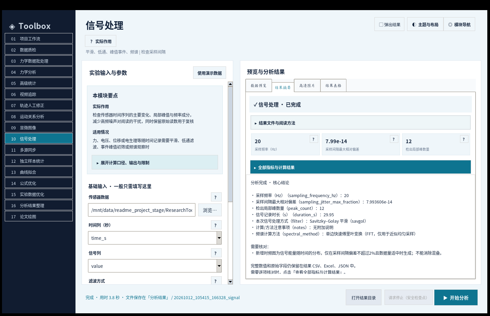
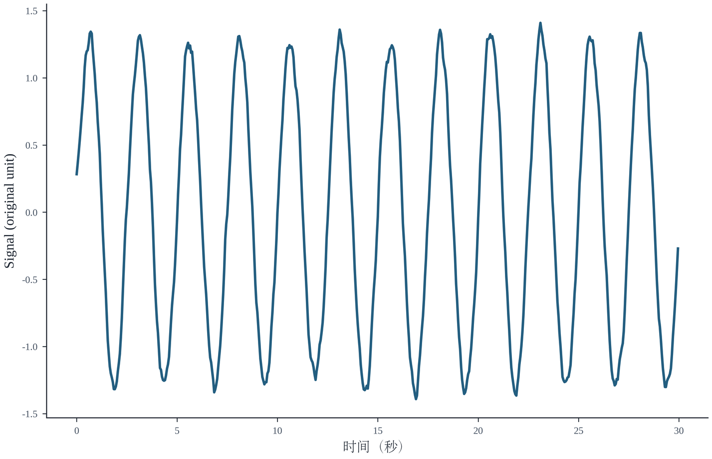
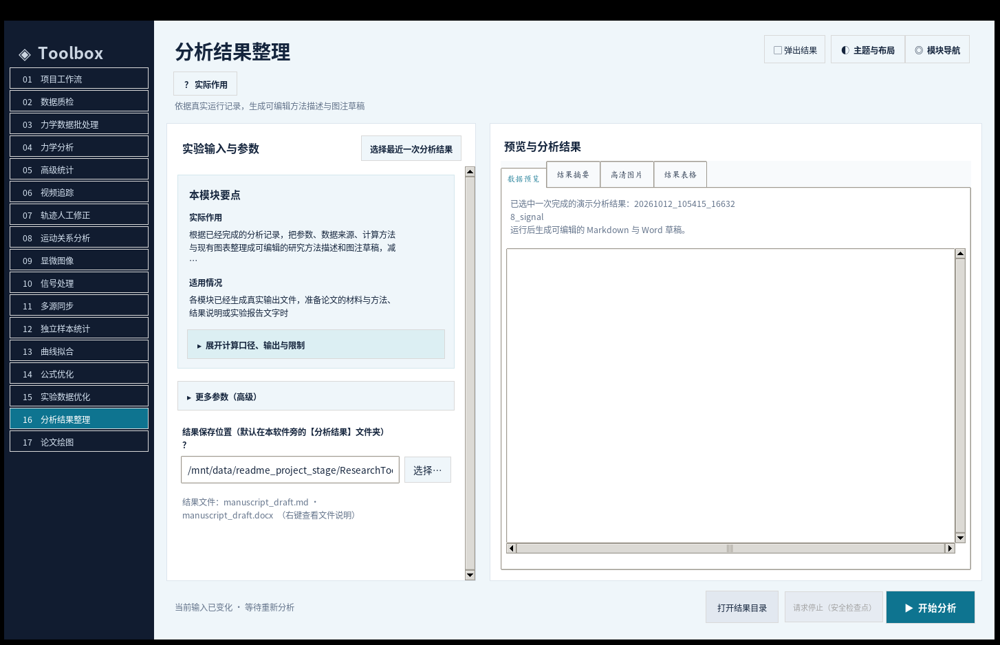

# Research Toolbox · 科研数据分析工具箱

**在本地整理实验数据、检查计算过程、绘制图表，并把分析结果保存为可以复查的文件。**

适用于日常科研中经常遇到的几类数据：力—位移曲线、传感器时间序列、视频特征点轨迹、显微图像、分组测量表格等。可以单独使用某个模块，也可以通过“项目工作流”整理来自多个实验设备的数据。同时支持**最优化计算**，**力学数据分析**，**实验优化推荐**，**实验数据处理**等等模块

这是一个较为通用的工具箱，理论上各种领域的数据都可以或多或少处理。分析在本机完成；第一次启动需要联网安装 Python 依赖，完全本地运行。

**运行环境：** Windows 10 / 11 · Python 3.11 / 3.12（推荐 64 位）  
**适用阶段：** 数据检查、探索性分析、结果复核、科研绘图和写作资料整理

> **第一次使用建议：** 不急着导入真实数据。先用 `samples/` 中的合成数据跑通一个模块，看看输入格式、输出位置和结果解释，再换成自己的实验记录。

## 目录

- [界面预览](#界面预览)
- [下载后怎么启动](#下载后怎么启动)
- [第一次使用：5 分钟跑通信号处理](#第一次使用5-分钟跑通信号处理)
- [有哪些分析模块](#有哪些分析模块)
- [常用操作：力学、视频、统计和写作](#常用操作力学视频统计和写作)
- [分析结果保存在哪里](#分析结果保存在哪里)
- [演示数据与文件格式](#演示数据与文件格式)
- [二维轨迹与三维重建](#二维轨迹与三维重建)
- [科研使用时需要确认的事情](#科研使用时需要确认的事情)
- [常见问题](#常见问题)
- [项目文件说明](#项目文件说明)

## 界面预览

下面是程序实际运行时截取的界面。不同电脑的字体和显示缩放可能稍有差异。

**主界面：左侧选模块，中间填参数，右侧查看预览与结果。**




### 环形浮动工作台

在「主题与布局」中选择「环形浮动工作台」，可以通过旋转圆环或右侧列表切换科研分析模块。



<details>
<summary>展开查看：信号处理输入界面</summary>



</details>

**计算完成后的结果摘要：**



**演示数据实际生成的信号分析图：**



<details>
<summary>展开查看：“分析结果整理”模块</summary>



</details>

## 下载后怎么启动

### 1. 准备运行环境

需要：

- Windows 10 或 Windows 11。
- **Python 3.11 或 3.12**，建议安装 64 位版本。安装时勾选 **Add Python to PATH**。
- 第一次运行时可以访问网络，用于安装 `requirements.txt` 中的依赖。
- 能够正常打开 CSV、Excel 和图片的常用软件，便于查看导出结果。

程序涉及的主要库包括 NumPy、SciPy、pandas、Matplotlib、scikit-learn、OpenCV、Pillow、openpyxl、python-docx 和 statsmodels。具体依赖以项目里的 `requirements.txt` 为准。

### 2. 解压并启动

1. **先把整个 ZIP 解压到一个普通文件夹**，不要直接在压缩包预览窗口中运行程序。
2. 打开解压后的 `ResearchToolbox` 文件夹。
3. 双击 **`一键启动_Windows.bat`**。
4. 首次启动会在软件目录下创建本地 Python 环境并安装依赖；完成后自动打开主窗口。这个过程可能需要几分钟。
5. 以后通常直接双击同一个启动文件即可。

建议把软件放在有读写权限的位置，例如 `D:\ResearchToolbox`；不要放在需要管理员权限才能写入的系统目录中。原始实验文件不必搬进软件文件夹，通过“浏览…”选择原有位置即可。

### 3. 手动启动（可选）

如果习惯使用命令行，可以在项目根目录执行：

```powershell
py -3.12 -m venv .venv
.venv\Scripts\python.exe -m pip install -r requirements.txt
.venv\Scripts\python.exe desktop.py
```

没有 Python 3.12、但安装了 3.11 时，将第一行的 `-3.12` 换成 `-3.11`。不熟悉命令行的话，按上一节双击启动即可。

## 第一次使用：5 分钟跑通信号处理

**推荐从“信号处理”开始**，它只需要一个简单的时间序列表格，不必先准备相机标定或复杂实验清单。

1. 启动程序，在左侧选择 **「信号处理」**。
2. 点击右上方的 **「使用演示数据」**，程序会加载 `samples/demo_signal.csv`。
3. 确认时间列为 `time_s`、信号列为 `value`。演示数据可以直接使用默认的 Savitzky–Golay 平滑参数。
4. 点击底部 **「开始分析」**。等待状态栏显示完成。
5. 在右侧切换 **「结果摘要」「高清图片」「结果表格」**，查看处理前后的数据和图。
6. 点击 **「打开结果目录」**，双击 `00_结果导航.html`，再进入 **「核心结果」** 查看 `filtered_signal.csv`、`detected_events.csv`、`fft_spectrum.csv` 和 `signal.png`。


其中：

- `filtered_signal.csv`：处理后的时间序列。
- `detected_events.csv`：满足当前峰值检测条件的候选事件。
- `fft_spectrum.csv`：频谱数据。
- `signal.png`：信号分析主图。根据模块和设置，还会生成相应的矢量图及辅助核验图。

> **注意：** 频谱是根据处理后的信号计算的。使用平滑或滤波后，不要只看处理结果；尤其在研究峰值和高频成分时，需要与原始信号比较。

## 有哪些分析模块

软件目前提供 **17 个主模块**。左侧名称是软件中可以直接选择的入口；下面的演示路径均以软件根目录为起点。

| 模块 | 能做什么 | 建议从哪个输入开始 |
| --- | --- | --- |
| **项目工作流** | 将同一研究项目中的视频、轨迹、力学、图像、信号与其他测量关联起来，记录各阶段处理状态 | `samples/多源科研项目/project_manifest.csv` |
| **数据质检** | 检查缺失、重复、异常值候选和表格字段，不擅自删除原始记录 | `samples/demo_force.csv` |
| **力学数据批处理** | 批量计算多份力—位移记录，汇总测试轮次、独立试样及实验条件 | `samples/batch_force/` |
| **力学分析** | 分析力—位移数据，进行测力零点校正、时间窗选择、峰值与积分计算 | `samples/demo_force.csv` |
| **高级统计** | 配对分析、多组比较、混合效应分析及标准不确定度合成 | `samples/demo_paired.csv` |
| **视频追踪** | 在视频中指定特征点并通过 LK 光流追踪，采用亚像素级定位，导出二维轨迹和复核视频 | `samples/demo_climbing.avi` 与 `samples/demo_video_point_anchors.csv` |
| **轨迹人工修正** | 对照原视频修正误跟踪点，保存变更记录并重新计算相关运动量 | 先完成一次视频追踪 |
| **运动关系分析** | 分析多个特征点的相对位置、速度、低速候选时段与点对关系 | `samples/通用轨迹/demo_generic_points.csv` |
| **显微图像** | 对图像进行阈值分割、区域测量和背景处理 | `samples/demo_contact.png` |
| **信号处理** | 滤波、事件检测、频谱及符合条件时的时频分析 | `samples/demo_signal.csv` |
| **多源同步** | 根据已有时间关系对齐两个设备的信号 | `samples/demo_signal.csv` 和 `samples/demo_signal_B.csv` |
| **独立样本统计** | 先在试样内合并重复测量，再进行分组描述和绘图 | `samples/demo_stats.csv` |
| **曲线拟合** | 线性、二次、指数或饱和模型拟合，并查看残差、RMSE 和 R² | `samples/demo_fit.csv` |
| **公式优化** | 根据自定义公式、参数边界与约束搜索候选数值解 | 模块中预填了可运行的公式示例 |
| **实验数据优化** | 用既有实验数据建立近似预测模型，评估可靠性并筛选下一轮待测参数 | `samples/demo_optimization.csv` |
| **分析结果整理** | 读取已完成的分析记录，生成可编辑的 Markdown、Word 研究文字草稿 | 先完成其他模块的一次分析 |
| **论文绘图** | 根据已有表格制作科研图，输出图片及可编辑的矢量格式 | `samples/demo_stats.csv` |

有些模块有较多可选参数。通常先完成“基础输入”，遇到特定实验需求再展开高级设置。输入框旁的 **「？」** 可以查看字段含义，不必一开始理解所有参数。

## 常用操作：力学、视频、统计和写作

### 1. 力学分析：从单条曲线到批量试样

**单份记录：** 左侧选择「力学分析」→「使用演示数据」→ 检查各列 →「开始分析」。对应示例是 `samples/demo_force.csv`。

原始表格至少要能识别时间、位移和力。例如演示文件的表头为：

```csv
condition,sample_id,time_s,displacement_mm,force_N
```

真正处理实验数据时，最重要的不是先点运行，而是确认下面几项：

1. **单位是否正确**：时间、位移和力的输入单位是否与仪器记录一致。
2. **力读数的正负方向**：需要分析的拉伸力究竟记录为正还是负。
3. **零点校正**：初始数据是否确实处于空载状态；如果不是，应指定可信的空载时间窗或其他合适的校正方法。
4. **分析时间窗**：明确哪一段属于需要研究的加载或拉离过程。
5. **独立试样编号**：同一试样测了多轮，不应直接当作多个独立试样。

**批量记录：** 改用「力学数据批处理」，选择装有多份 CSV／Excel 的文件夹，例如 `samples/batch_force/`。建议先读 `import_manifest.csv` 核对每个文件的识别情况，再看逐轮指标、独立试样汇总及分组结果。

计算中的“正向力—位移积分”单位通常为 **mJ（N·mm）**，它可能包含试验装置、试样变形和其他耗能。**不要仅凭这个积分就将结果命名为材料固有黏附能或界面断裂能。** 是否属于法向、切向或剥离加载，也必须以实际试验规程为准。

### 2. 视频追踪：先标点，再复核轨迹

1. 选择「视频追踪」，加载视频。第一次可以使用 `samples/demo_climbing.avi`。
2. 推荐使用 **人工点锚定 LK 光流**；在原始画面中标记真实、清晰、能够连续辨认的特征点，或加载相应锚点 CSV。
3. 如果要把像素位移换算成毫米，必须提供并确认真实标尺；没有标定时应按像素量解释。
4. 点击「开始分析」，查看 `frame_trajectory.csv`，并优先检查输出的追踪叠加视频及质量复核记录。
5. 某些帧跟错了，可进入「轨迹人工修正」，对照原视频修改位置并保留修改记录。
6. 需要研究多个点之间的距离、方向或运动阶段时，再使用「运动关系分析」。

二维视频给出的是图像平面中的运动。**不能仅凭一台普通相机的二维轨迹，推断真实三维位移或空间深度。** 视频中的连续帧也不是彼此独立的生物学试样。

**涉及双目三维时**，请先读 [《三维视频处理与二维.md》](三维视频处理与二维.md)，以及 `双目标定与三维重建演示/README_双目演示四步.txt`。不做三维分析时，不需要填写三维标定参数。

### 3. 独立样本统计：区分“测量次数”和“试样数量”

选择「独立样本统计」，点击「使用演示数据」，读取 `samples/demo_stats.csv`。

这个演示数据中包括：

```csv
condition,sample_id,trial_id,value
```

`trial_id` 是同一试样的重复测量编号，`sample_id` 才用来识别独立试样。程序可以先得到试样层面的汇总，再进行组间描述。**不能因为每块试样测量了多次，就把所有重复测量数直接当成独立样本数 n。**

「高级统计」可进一步完成配对或多组分析，但统计方法需要由实验设计决定，不能只根据哪个检验的 p 值更小来选。

### 4. 论文绘图：先核对表格列，再设置坐标

选择「论文绘图」，载入带有 X、Y 和分组信息的数据表。演示可用 `samples/demo_stats.csv`。

建议按以下顺序：先确认纵轴代表的物理量及单位，再选择分组和独立试样列，最后设置图型、坐标标题及导出格式。软件可输出 PNG 等图片，以及 SVG／PDF 等矢量格式（视模块而定）。图上的 n、误差条含义、标尺和统计标注仍需根据实际数据核对。

### 5. 分析结果整理：从一次真实运行记录生成 Word 草稿

这个模块不是空白的 Word 模板编辑器；它会读取**本软件此前已经完成的一次分析**，把保存的参数和结果整理成可以继续修改的文字。

操作方法：

1. 先用其他模块完成一次分析，例如上面的「信号处理」。
2. 切换到 **「分析结果整理」**。
3. 在输入栏填写**已完成的结果文件夹路径**；或者点击 **「浏览…」**，进入那次结果下的 **`运行记录/`**，选择 `run_metadata.json`。不要在结果根目录寻找这个 JSON，它保存在分类文件夹内。
4. 选择写作语言，点击 **「开始分析」**。
5. 在这次写作任务的 **`核心结果/`** 中找到 `manuscript_draft.md` 和 `manuscript_draft.docx`。


Word 文档使用中文 **微软雅黑**、英文 **Times New Roman**。草稿记录的是已保存的参数和计算观察，并不自动补全真实实验条件、参考文献或研究结论。用于论文之前仍需自己核对、改写。

### 6. 项目工作流：一个实验对应多种来源文件

当视频、力学、图像和传感器来自同一批实验，而你不想手工整理很多个单独的结果目录时，可以使用「项目工作流」。

- 输入一个实验清单 CSV，每行对应一项实验，写明实验编号、试样编号、组别及数据文件路径。
- 可先用 `samples/多源科研项目/project_manifest.csv` 和同目录的 `README_先读这里.md` 了解格式。
- 确认各设备记录指向**同一次真实实验**，并按需启用统计、同步或优化阶段。
- 运行后查看 `项目结果导航.html`、阶段状态文件和逐实验联合指标表。

完整多源项目涉及的视频和图像处理可能耗时较长。初次接触时，建议先用单个模块熟悉输出结构。示例清单里的实验编号、标定和时间关系只适用于合成演示，不应原封不动套到自己的实验上。

## 分析结果保存在哪里

默认情况下，运行结果保存在软件根目录下的 **`分析结果/`**。每次运行会建立独立的任务目录，不覆盖上一轮结果。也可以在模块下方的 **「结果保存位置」** 自行指定其他文件夹。

以一次信号处理为例：

```text
ResearchToolbox/
└── 分析结果/
    └── <本次运行的文件夹>/
        ├── 00_结果导航.html
        ├── 核心结果/
        │   ├── filtered_signal.csv
        │   ├── detected_events.csv
        │   ├── fft_spectrum.csv
        │   ├── signal.png
        │   └── analysis_tables.xlsx
        ├── 质量检查/
        │   └── ... 诊断表和辅助复核图
        └── 运行记录/
            ├── run_metadata.json
            ├── result_summary.json
            └── ... 参数及结果说明
```

不同模块生成的文件不同，**以本次运行实际生成的文件为准**。

| 文件夹 | 主要放什么 | 什么时候看 |
| --- | --- | --- |
| `核心结果/` | 主要 CSV、Excel、图片、可编辑文稿 | 第一次查看分析结果时 |
| `质量检查/` | 诊断表、辅助图、算法或数据质量提示 | 对结果有疑问，或准备写入论文前 |
| `运行记录/` | 参数、输入来源、结果摘要、阅读说明 | 需要复查分析设置或整理结果时 |

最省事的阅读方式：**先打开 `00_结果导航.html` → 再看核心结果 → 遇到疑点查质量检查和运行记录**。根目录不会再额外存一份同名计算文件。

软件结果页还可以查看数据预览、结果摘要、图片及表格；旁边的问号和展开项可用来查找数值的含义。CSV、Excel、JSON 中的英文列名用于记录和追溯，界面上会尽量给出中文名称。

## 演示数据与文件格式

`samples/` 里附带的 CSV、图像和视频**全部是合成演示数据**，用途是熟悉输入格式、理解操作顺序、检查软件输出；它们不属于任何真实实验，也不能作为论文中的实测证据。

常用文件：

```text
samples/
├── demo_force.csv                  # 单份力—位移记录
├── batch_force/                   # 多份力学记录
├── demo_signal.csv                 # 传感器时间序列
├── demo_signal_B.csv               # 第二路传感器信号
├── demo_stats.csv                  # 分组及重复测量
├── demo_paired.csv                 # 配对统计数据
├── demo_fit.csv                    # X/Y 曲线拟合
├── demo_optimization.csv           # 参数—响应实验记录
├── demo_contact.png                # 显微图像分割示例
├── demo_climbing.avi               # 视频追踪示例
├── 通用轨迹/demo_generic_points.csv
├── 双目标定演示/                  # 合成双目视频及标定数据
└── 多源科研项目/project_manifest.csv
```

另外，顶层的 `双目标定与三维重建演示/` 提供了一组便于直接查看的双目演示文件。

导入自己的数据时建议保留原始文件的备份，并逐项确认：

- **列名**：时间、力、位移、响应量、组别和试样编号是否映射到了正确列。
- **单位**：例如 N 与 mN、mm 与 µm、秒与毫秒不能混用。
- **时间**：时间戳是否递增、采样是否均匀、设备间是否真的存在已知的同步关系。
- **试样身份**：实验轮次、视频帧、图像区域和独立试样编号是不同概念。
- **标定**：像素到物理长度的换算应来自真实标定，不应直接沿用演示默认值。

支持的文件类型由模块决定，常见的是 CSV、TSV、Excel、PNG／TIFF 图片和 AVI／MP4 视频。文件表头和设备输出各有差异，无法可靠识别时应手动指定列，不建议为了让程序运行而随意改写真实数据。

## 二维轨迹与三维重建

这里单独说明，是因为两种结果很容易混淆。

**二维视频追踪**得到的是相机图像平面中的点坐标、投影速度及相对运动；即使结果显示为毫米，如果缺少可靠比例尺，也不应当作真实物理位移解释。

**真实三维重建**需要足够的额外几何信息，例如：

- 两台相机的内外参标定、对应时刻及对应物理点，用于双目三角测量。
- 已知真实三维几何的刚体点，用于特定的位姿估计方法。

只把单目视频复制成左右两个文件，不能得到有效的真实深度。`samples/双目标定演示/` 与 `双目标定与三维重建演示/` 的标定 JSON 只适用于配套合成输入，**不能拿来标定自己的真实摄像机**。

具体操作请读 [三维视频处理与二维.md](三维视频处理与二维.md)。

## 科研使用时需要确认的事情

本工具箱负责辅助整理、计算、可视化和复核，**不能替代实验记录、仪器标定、试验规程或研究者的科学判断**。阅读结果时，建议牢记几条原则：

1. **先核对输入，再解读结果。** 重点看原始列名、单位、力读数方向、分析时间窗、试样编号以及实际生效参数。
2. **力—位移积分不是材料固有黏附能。** 它属于规定积分范围下的机械功量，具体物理解释需要实验模型支持。
3. **重复测量不等于独立样本。** 同一试样的多个循环、连续视频帧不能直接当作多份独立试样。
4. **三维处理。** 需要深度、真实长度和空间角度需要可信的额外标定或观测条件。
5. **滤波会影响信号。** 检测到的峰值、时域变化和频谱特征，应回到原始信号核查。
6. **优化结果是待验证候选。** 无论公式优化还是实验数据优化，得到的参数都不代表已经完成新实验，也不等于获得全局最优的科学证明。
7. **统计结论依赖研究设计。** 是否配对、真正的 n 是多少、误差条表达什么，需要事先明确；重要结论建议使用独立方法交叉核验。

这些提醒不意味着每份输出都有错误，而是说明**软件的计算结果必须放回真实实验背景中解释**。如果某一步缺少必要的标定、独立样本信息或实验条件，宁可保留“待确认”，也不要根据图表外观替它补出结论。

## 常见问题

<details>
<summary><strong>双击启动文件后没有打开窗口？</strong></summary>

确认整个项目已经解压；检查 Python 是否为 3.11 或 3.12，以及首次安装依赖时的网络是否正常。不要只把启动文件单独复制到桌面运行。如果出现错误提示，保留启动窗口中的原始报错，便于检查缺失的依赖或文件。

</details>

<details>
<summary><strong>“使用演示数据”有的模块不能直接运行？</strong></summary>

有些模块依赖上一阶段的输出。例如「轨迹人工修正」需要已经生成的轨迹和人工修正记录；「分析结果整理」需要一次已完成的分析；「公式优化」则使用界面中预填的数学示例，不需要 CSV。不是所有模块都能用一份通用输入表完成。

</details>

<details>
<summary><strong>“分析结果整理”无法自动找到最近一次结果？</strong></summary>

可以直接把已经完成的任务文件夹路径填到输入框，或点击「浏览…」，进入该任务的 `运行记录/` 选择 `run_metadata.json`。分类保存的记录文件并不在任务根目录；手动指定是可靠的操作方式。

</details>

<details>
<summary><strong>运行结束后，CSV 和图片在哪里？</strong></summary>

点击「打开结果目录」，打开本次任务下的 `00_结果导航.html`。主要文件通常在 `核心结果/`，诊断与检查文件在 `质量检查/`，运行参数在 `运行记录/`。如果修改过「结果保存位置」，结果将保存到你指定的文件夹。

</details>

<details>
<summary><strong>为什么结果中有英文字段？</strong></summary>

如 `sampling_frequency_hz`、`peak_count`、`peak_force_N` 等，是保存到数据表和 JSON 的字段标识，方便与原始文件和其他脚本对照。界面中的中文解释用于阅读，完整计算值仍以导出的数值表为准。**字段名并不自动说明物理结论**，尤其要核对单位与适用的分析模块。

</details>

<details>
<summary><strong>软件算出的峰值、拟合参数或优化结果能直接写进论文吗？</strong></summary>

不要只复制摘要里的一个数字。请先检查输入、算法参数、质量诊断、样本独立性和计算明细；图注中的实验条件、n、标尺和误差条定义也需要人工确认。「分析结果整理」导出的 Word 是编辑起点，不是自动完成的论文。

</details>

<details>
<summary><strong>可以直接用演示文件中的三维标定或物理单位处理自己的视频吗？</strong></summary>

不可以。合成文件的相机参数、标尺及时间关系只为配套演示准备。实际实验必须重新标定，并确认左右视角对应的是同一物理点。

</details>

## 项目文件说明

```text
ResearchToolbox/
├── 一键启动_Windows.bat              # Windows 启动入口
├── desktop.py                        # 桌面主界面
├── core/                             # 数据处理、绘图和科研计算逻辑
├── ui_*.py                           # 交互界面、字段帮助与结果查看
├── requirements.txt                  # Python 运行依赖
├── samples/                          # 合成演示输入
├── 双目标定与三维重建演示/           # 合成双目视频与标定示例
├── 三维视频处理与二维.md            # 二维追踪及三维处理操作指南
├── assets/screenshots/               # README 使用的实际界面截图
├── matlab/                           # 独立 MATLAB 示例代码
└── c/                                # 独立 C 示例代码
```

**建议的使用顺序：** 先用演示数据了解程序 → 导入真实实验记录 → 检查单位、标定和独立样本 → 运行分析 → 阅读分类结果和质量检查 → 必要时用其他工具或独立计算复核。

---

如果只是想快速了解能否处理手头的数据，先从一份 CSV 开始即可。复杂项目可以等单个模块的输入输出确认无误后，再交给「项目工作流」统一整理。


## License

Research Toolbox is licensed under the [PolyForm Noncommercial License 1.0.0](LICENSE.md).

Noncommercial use, modification, and redistribution are permitted under the license terms. Commercial use requires separate permission from the copyright holder.

